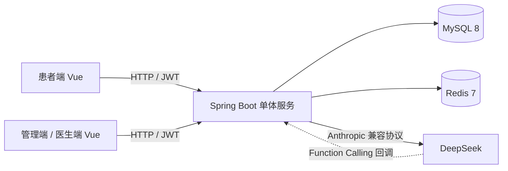

# 智慧医院就医服务系统

> 面向患者的轻量线上就医平台：**高并发挂号 + AI 导诊 Agent**
> 单体架构、窄而深。不堆中间件，把两条主线的并发与状态一致性做扎实。

## 一、项目简介

前后端分离的线上就医平台，覆盖患者从「AI 导诊 → 预约挂号 → 支付 → 到院签到 → 医生叫号 → 查询报告」的完整链路，另含管理端（科室 / 医生 / 排班维护）。

## 二、技术栈

| 分类 | 技术 |
|------|------|
| 语言 / 运行时 | JDK 17 |
| 框架 | Spring Boot 3.4.5、Spring Security（JWT） |
| 持久层 | MyBatis-Plus 3.5.12（含 `mybatis-plus-jsqlparser`）、MySQL 8 |
| 缓存 | Redis 7（库存预扣、导诊限流） |
| AI | Spring AI 1.0（`spring-ai-starter-model-anthropic`，经 Anthropic 兼容协议接 DeepSeek） |
| 前端 | Vue 3 + TypeScript + Vite + Element Plus + Pinia + Vue Router |
| 接口文档 | Knife4j（UI）+ springdoc-openapi 2.8.9（文档引擎） |
| 部署 / 压测 | Docker Compose（MySQL + Redis + App）、k6 |

## 三、系统架构



**架构要点**

- 2 个前端工程形态：患者端 / 管理端，医生作为独立角色区（`/doctor`），不单独拆工程
- 1 个后端单体，controller / service / mapper 分层
- 中间件只有 MySQL + Redis。**没有消息队列、没有分布式锁、没有向量库**——并发正确性由「Lua 原子扣减 + 数据库条件更新 + 唯一键」三道保证

## 四、核心亮点

### 1. 挂号防超卖链路

| 环节 | 真实做法 |
|------|----------|
| 库存预扣 | Redis `stock:schedule:{id}` + Lua 脚本原子扣减，把绝大多数无效请求挡在数据库外 |
| 数据库兜底 | `left_num > 0` 条件 UPDATE，Redis 与库不一致时以库为准 |
| 一人一单 | `tb_order` 唯一键（`patient_id + schedule_id + active_flag`），退号 / 取消时 `active_flag` 置 NULL 让位 |
| 号源状态机 | 号源行 0 可用 → 1 锁定 → 2 已售出 → 3 已就诊，每步都是条件 UPDATE 并检查影响行数 |
| 超时释放 | 定时任务扫 MySQL 待支付超时订单，条件 UPDATE 幂等回补库存与号源 |
| 支付 / 退号并发 | 支付与超时释放抢同一条单时，靠条件 UPDATE 保证只有一个成功 |
| 订单姓名快照 | 下单时把就诊人姓名写入 `tb_order.patient_name`，之后就诊人改名不影响历史订单显示 |

**为什么不用分布式锁**：一人一单由数据库唯一键兜底，锁只是性能优化；在单体 + 单库场景下引入 Redisson 收益不匹配复杂度。

### 2. AI 导诊 Agent（Function Calling）

不是单轮问答，是模型自主编排工具：

- 暴露 3 个 `@Tool` 方法：查科室、查医生、查最近 7 天可约号源
- 模型根据症状**自己决定调用链路与次数**，查到的都是库内真实数据，因此不需要"回库校验模型是否编造科室名"
- 工程护栏：Redis 5 秒限流（Agent 一次回答多次调用模型，比单轮更烧钱）；模型故障时优雅降级为引导文案，不抛 500
- **SSE 流式输出**：支持打字机效果，前端可切换流式/非流式；流末尾推送结构化号源，兼顾体验与功能

### 3. 完整就医闭环

```
AI 导诊 → 添加就诊人（实名）→ 挂号 → 支付 → 到院签到 → 进入候诊队列 → 医生叫号 → 查询报告
                                    ↘ 退号 / 超时未支付 → 库存与号源回补
```

## 五、功能清单

**患者端**

- 注册 / 登录（JWT）
- 就诊人管理（增删改、身份证脱敏展示、有挂号记录禁止删除；**挂号前必须先建档**，需真实姓名与身份证）
- 科室 / 医生 / 排班浏览
- 挂号下单、我的订单（分页 + 状态筛选）
- 模拟支付、退号退款、到院签到
- 检验报告查询
- AI 导诊

**管理端（管理员）**

- 数据看板（今日挂号/收入、订单状态分布、科室 TOP8、7 天趋势，ECharts 图表）
- 科室管理 / 医生管理（分页 CRUD；新增医生时用手机号自动开户并绑定，无需手工建账号）
- 排班管理（放号、改号、停诊、删除）

**医生端**

- 我的出诊排班、候诊队列
- 叫号 → 完成接诊、开具检验报告

## 六、快速开始

### 演示账号

| 角色 | 账号 | 密码 | 说明 |
|---|---|---|---|
| 管理员 | `admin` | `admin123` | 后端启动时自动创建 |
| 医生 | `doctor001` ~ `doctor005` | `admin123` | 分别绑定 5 位出诊医生，登录后只看到自己的排班与候诊 |
| 患者 | 自行注册 | — | 注册只建账号；挂号前需先添加就诊人（真实姓名、身份证），也可用 `perf001` ~ `perf500` 压测账号 |

医生账号与医生档案通过 `tb_doctor.user_id` 绑定；管理端新增医生时由后端在同一事务内建账号（用户名=手机号，初始密码 `admin123`）。

### 方式一：Docker Compose（推荐）

```bash
docker compose up -d --build
```

首次启动自动建表并灌入演示数据（5 科室 / 6 医生 / 排班与号源 / 500 个压测账号）。

> **改了代码必须带 `--build`**：前后端镜像都是多阶段构建，在镜像内编译；`docker compose up -d` 只用旧镜像，代码不会生效。首次构建要下载 Maven/npm 依赖，会慢几分钟。

- 前端入口：`http://localhost:5173`（nginx 托管静态资源，并把 `/api` 转发给后端）
- 后端应用：`http://localhost:8080`
- 接口文档：`http://localhost:8080/doc.html`
- MySQL 映射到宿主机 `3307`（避开本机 3306）

密钥通过根目录 `.env` 注入（不入库），代码内全部是 `${PLACEHOLDER}` 占位。

### 方式二：本地开发

```bash
# 后端（工作目录 hospital-service，会自动读取根目录 .env 里的连接参数）
cd hospital-service
mvn spring-boot:run

# 前端（另起终端）
cd hospital-web
npm install
npm run dev        # http://localhost:5173
```

后端通过 `spring.config.import` 自动读取根目录 `.env`，本地开发不用手动设环境变量。**.env 里必须把 MySQL / Redis 指向容器映射的端口**（本机 3306、6379 常被原生 MySQL/Redis 占用）：

```properties
MYSQL_HOST=127.0.0.1
MYSQL_PORT=3307
MYSQL_PASSWORD=123456
REDIS_HOST=127.0.0.1
REDIS_PORT=6380
```

> 两个端口不一致是"测试能过、页面数据不对"的头号原因：`mvn test`、压测和容器里的数据都在 3307/6380，本地后端若用默认 3306/6379，连的就是另一套库。

前端通过 Vite proxy 把 `/api` 转发到 `localhost:8080` 并剥掉前缀，无需跨域配置。

## 七、压测与测试

```bash
# 后端（10 个集成测试，连真实 MySQL + Redis，不 mock）
cd hospital-service && mvn test

# 前端（326 个用例）
cd hospital-web && npm test -- --maxWorkers=4

# 并发压测（k6）：下单不超卖
k6 run load-test/order-concurrency.js

# 退号回补压测（先重置数据，跑完用 SQL 对账）
Get-Content load-test\reset-perf-data.sql | docker exec -i hospital-mysql mysql -uroot -p123456
docker exec hospital-redis redis-cli DEL stock:9001
k6 run load-test/refund-concurrency.js
Get-Content load-test\reconcile-perf.sql | docker exec -i hospital-mysql mysql -uroot -p123456
```

**后端测试覆盖什么**（并发正确性依赖真实行锁与唯一键，内存库测不出真相，所以集成测试直连 MySQL/Redis）：

| 测试类 | 验证的不变量 |
|---|---|
| `OrderConcurrencyTest` | 15 线程抢 5 个号恰好成交 5 单、库存归零；同一就诊人重复挂号被拒、退号后让位可重挂；支付与超时释放并发只有一方生效且号源 / 库存 / 支付单三方一致；退号 / 叫号 / 开报告 / 完成接诊的非法状态全部拒绝 |
| `AuthFlowTest` | 注册 → 重复注册 → 登录 → 带 token 取用户 → 角色越权 403 |
| `MapperSmokeTest` | 9 张表实体字段与库表列一致 |

**压测结论（下单）**：500 并发抢 20 个号 → 成交 20、拒绝 480、**零超卖**；数据库对账（订单数 / 剩余库存 / 锁定号源）三方一致。p50 744ms 的耗时主要在 Tomcat 线程排队，而非业务执行。

**压测结论（退号回补）**：500 并发抢 20 个号 → 20 单支付后退号 → 同一批人再抢，**又成交 20**；对账 `left_num=0`、有效订单 20、锁定号源 20 全部 PASS，重复挂号 0。说明退号的逆向链路（订单让位 / 号源回可用 / 库存回补 / 缓存作废）是完整的。首轮另有 54 个请求被 Tomcat 的 accept 队列（默认 100）拒绝，属连接层现象，不是业务失败。

**CI**：push / PR 自动跑前后端全量测试（`.github/workflows/ci.yml`，用 service 容器起 MySQL 8 + Redis 7 并导入 `sql/` 初始数据）。

## 八、项目结构

```
hospital-project/
├── README.md
├── docker-compose.yml      # MySQL + Redis + App 一键起
├── docs/                   # 设计文档、开发规范
├── sql/
│   ├── schema.sql          # 9 张表
│   └── data.sql            # 演示与压测数据
├── hospital-service/       # Spring Boot 后端
├── hospital-web/           # Vue 3 前端（患者 / 管理 / 医生）
└── load-test/              # k6 压测脚本
```

## 九、刻意简化与未实现项

为避免"宣传的术栈"与实现脱节，明确列出边界：

- **支付为模拟支付**，未接微信 / 支付宝真实渠道
- **号源只有四态**（可用 / 锁定 / 已售出 / 已就诊）：订单有"就诊中"这一态，但号源在叫号时就置为"已就诊"，不再细分
- AI 导诊**无 RAG 知识库、无 SSE 流式输出、无会话记忆**，为单轮 Agent 工具调用
- **无消息队列**：下单为同步 Lua 预扣 + 事务落库，超时释放为定时任务扫表，未使用 Redis Stream / ZSet 延迟队列
- **无分布式锁**：并发正确性由数据库唯一键与条件更新保证
- 管理端**无数据看板**，无挂号单审核流程

## 十、后续计划

- 接真实支付渠道（微信 / 支付宝异步回调），替换当前模拟支付
- 补退号回补的 k6 脚本（当前压测只覆盖下单链路）
- 管理端数据看板、界面截图
