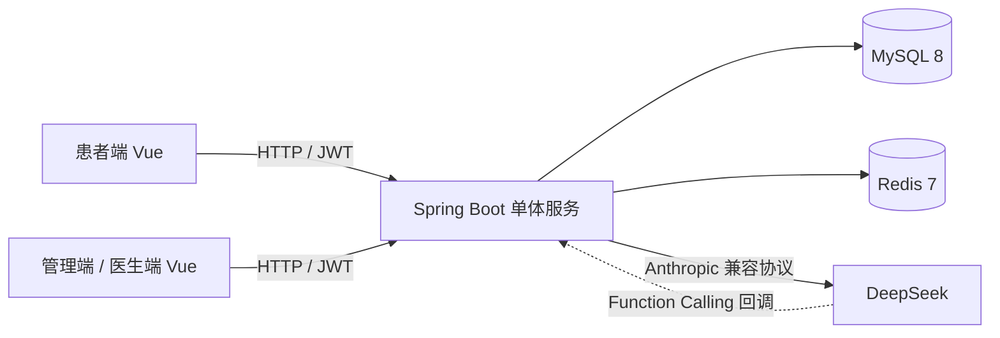

# 智慧医院就医服务系统

> 面向患者的轻量线上就医平台：**高并发挂号 + AI 导诊 Agent**
> 单体架构、窄而深。不堆中间件，把两条主线的并发与状态一致性做扎实。

## 一、项目简介

前后端分离的线上就医平台，覆盖患者从「AI 导诊 → 预约挂号 → 支付 → 到院签到 → 医生叫号 → 查询报告」的完整链路，另含管理端（科室 / 医生 / 排班维护）。

## 二、技术栈

| 分类 | 技术 |
|------|------|
| 语言 / 运行时 | JDK 17 |
| 框架 | Spring Boot 3.4.5、Spring Security（JWT） |
| 持久层 | MyBatis-Plus 3.5.12（含 `mybatis-plus-jsqlparser`）、MySQL 8 |
| 缓存 | Redis 7（库存预扣、导诊限流） |
| AI | Spring AI 1.0（`spring-ai-starter-model-anthropic`，经 Anthropic 兼容协议接 DeepSeek） |
| 前端 | Vue 3 + TypeScript + Vite + Element Plus + Pinia + Vue Router |
| 接口文档 | Knife4j（UI）+ springdoc-openapi 2.8.9（文档引擎） |
| 部署 / 压测 | Docker Compose（MySQL + Redis + App）、k6 |

## 三、系统架构



**架构要点**

- 2 个前端工程形态：患者端 / 管理端，医生作为独立角色区（`/doctor`），不单独拆工程
- 1 个后端单体，controller / service / mapper 分层
- 中间件只有 MySQL + Redis。**没有消息队列、没有分布式锁、没有向量库**——并发正确性由「Lua 原子扣减 + 数据库条件更新 + 唯一键」三道保证

## 四、核心亮点

### 1. 挂号防超卖链路

| 环节 | 真实做法 |
|------|----------|
| 库存预扣 | Redis `stock:schedule:{id}` + Lua 脚本原子扣减，把绝大多数无效请求挡在数据库外 |
| 数据库兜底 | `left_num > 0` 条件 UPDATE，Redis 与库不一致时以库为准 |
| 一人一单 | `tb_order` 唯一键（`patient_id + schedule_id + active_flag`），退号 / 取消时 `active_flag` 置 NULL 让位 |
| 号源状态机 | 号源行 0 可用 → 1 锁定 → 2 已售出 → 3 已就诊，每步都是条件 UPDATE 并检查影响行数 |
| 超时释放 | 定时任务扫 MySQL 待支付超时订单，条件 UPDATE 幂等回补库存与号源 |
| 支付 / 退号并发 | 支付与超时释放抢同一条单时，靠条件 UPDATE 保证只有一个成功 |

**为什么不用分布式锁**：一人一单由数据库唯一键兜底，锁只是性能优化；在单体 + 单库场景下引入 Redisson 收益不匹配复杂度。

### 2. AI 导诊 Agent（Function Calling）

不是单轮问答，是模型自主编排工具：

- 暴露 3 个 `@Tool` 方法：查科室、查医生、查最近 7 天可约号源
- 模型根据症状**自己决定调用链路与次数**，查到的都是库内真实数据，因此不需要"回库校验模型是否编造科室名"
- 工程护栏：Redis 5 秒限流（Agent 一次回答多次调用模型，比单轮更烧钱）；模型故障时优雅降级为引导文案，不抛 500

### 3. 完整就医闭环

```
AI 导诊 → 挂号 → 支付 → 到院签到 → 进入候诊队列 → 医生叫号 → 查询报告
                ↘ 退号 / 超时未支付 → 库存与号源回补
```

## 五、功能清单

**患者端**

- 注册 / 登录（JWT，注册即自动创建"本人"就诊人）
- 就诊人管理（增删改、身份证脱敏展示、有挂号记录禁止删除）
- 科室 / 医生 / 排班浏览
- 挂号下单、我的订单（分页 + 状态筛选）
- 模拟支付、退号退款、到院签到
- 检验报告查询
- AI 导诊

**管理端（管理员）**

- 科室管理 / 医生管理（分页 CRUD）
- 排班管理（放号、改号、停诊、删除）

**医生端**

- 我的出诊排班、候诊队列
- 叫号、开具检验报告

## 六、快速开始

### 方式一：Docker Compose（推荐）

```bash
docker compose up -d --build
```

首次启动自动建表并灌入演示数据（5 科室 / 6 医生 / 排班与号源 / 500 个压测账号）。

- 应用：`http://localhost:8080`
- 接口文档：`http://localhost:8080/doc.html`
- MySQL 映射到宿主机 `3307`（避开本机 3306）

密钥通过根目录 `.env` 注入（不入库），代码内全部是 `${PLACEHOLDER}` 占位。

### 方式二：本地开发

```bash
# 后端
cd hospital-service
mvn spring-boot:run

# 前端（另起终端）
cd hospital-web
npm install
npm run dev        # http://localhost:5173
```

前端通过 Vite proxy 把 `/api` 转发到 `localhost:8080` 并剥掉前缀，无需跨域配置。

## 七、压测与测试

```bash
# 后端
cd hospital-service && mvn test

# 前端（316 个用例）
cd hospital-web && npm test -- --maxWorkers=4

# 并发压测（k6）
k6 run load-test/order-concurrency.js
```

**压测结论**：500 并发抢 20 个号 → 成交 20、拒绝 480、**零超卖**；数据库对账（订单数 / 剩余库存 / 锁定号源）三方一致。p50 744ms 的耗时主要在 Tomcat 线程排队，而非业务执行。

## 八、项目结构

```
hospital-project/
├── README.md
├── docker-compose.yml      # MySQL + Redis + App 一键起
├── docs/                   # 设计文档、开发规范
├── sql/
│   ├── schema.sql          # 9 张表
│   └── data.sql            # 演示与压测数据
├── hospital-service/       # Spring Boot 后端
├── hospital-web/           # Vue 3 前端（患者 / 管理 / 医生）
└── load-test/              # k6 压测脚本
```

## 九、刻意简化与未实现项

为避免"宣传的术栈"与实现脱节，明确列出边界：

- **支付为模拟支付**，未接微信 / 支付宝真实渠道
- **叫号即完成接诊**，未单独设"就诊中"状态（简化模型，有并发保护）
- AI 导诊**无 RAG 知识库、无 SSE 流式输出、无会话记忆**，为单轮 Agent 工具调用
- **无消息队列**：下单为同步 Lua 预扣 + 事务落库，超时释放为定时任务扫表，未使用 Redis Stream / ZSet 延迟队列
- **无分布式锁**：并发正确性由数据库唯一键与条件更新保证
- 管理端**无数据看板**，无挂号单审核流程

## 十、后续计划

- 补充挂号并发、一人一单、支付与超时释放并发、非法状态流转的后端测试
- AI 导诊工具返回结构化排班（含 `scheduleId`），打通"推荐号源 → 一键挂号"
- 补 CI、前端生产部署（nginx）配置与界面截图
