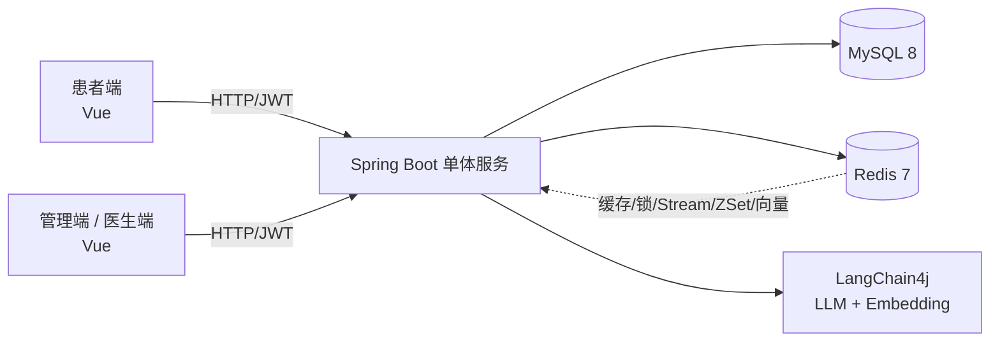

# 智慧医院就医服务系统

> 面向患者的轻量线上就医平台：**高并发挂号秒杀 + AI 智能导诊**

## 一、项目简介

智慧医院就医服务系统是一个前后端分离的线上就医平台，覆盖患者从「预约挂号 → 到院签到 → 叫号就诊 → 查询报告」的完整就医链路。

项目刻意保持**单体架构、窄而深**，把精力集中在两条技术主线：

- **高并发挂号（秒杀）**：Redis 预扣库存 + Lua 原子扣减 + 分布式锁 + 一人一单 + 延迟队列释放
- **AI 智能导诊**：RAG 知识库问答 + Function Calling 打通号源查询

## 二、技术栈

| 分类 | 技术 |
|------|------|
| 语言 / 运行时 | JDK 17 |
| 框架 | Spring Boot 3.x、Spring Security |
| 持久层 | MyBatis-Plus 3.5.7、MySQL 8 |
| 缓存 / 中间件 | Redis 7（缓存、分布式锁、Stream、ZSet 延迟队列、向量检索） |
| AI | LangChain4j、Redis Vector Search |
| 构建 / 工具 | Maven、Lombok、Knife4j（接口文档） |

## 三、系统架构



**架构要点**

- 2 个前端（患者端、管理端），医生作为管理端里的角色，不单独拆工程
- 1 个后端单体，按 controller / service / mapper 分层
- 中间件收敛为 MySQL + Redis，Redis 一挑五：缓存、分布式锁、Stream 队列、ZSet 延迟队列、向量检索

## 四、核心亮点

### 1. 秒杀防超卖链路

| 环节 | 方案 |
|------|------|
| 库存预扣 | Redis `stock:schedule:{id}` + Lua 脚本原子扣减 |
| 一人一单 | Redisson 分布式锁，**按就诊人维度**（`patientId` 而非 `userId`） |
| 异步下单 | Redis Stream 生产者 / 消费者组，削峰填谷 |
| 未支付释放 | ZSet 以支付截止时间为 score，定时扫描到期订单回补号源 |
| 幂等 | `order:no` 唯一 + Redis 幂等标记，防重复提交 |

### 2. AI 智能导诊

- **RAG**：医院知识库（科室介绍、就医流程、医保政策）切片入库，Redis Vector Search 检索
- **Function Calling**：患者问「明天呼吸科还有号吗」，Agent 调用号源查询接口返回实时数据
- **合规护栏**：只做流程答疑，不做诊断建议，敏感问题拒答并引导线下就医
- **SSE 流式输出** + 会话记忆存 Redis

### 3. 完整就医闭环

```
挂号 → 支付 → 到院签到 → 进入叫号队列 → 医生叫号 → 就诊完成 → 查询报告
                    ↘ 退号 / 爽约 → 号源回补
```

## 五、功能清单

**患者端**

- 登录 / 注册（JWT）
- 就诊人管理（实名制，一个账号可挂多个家人）
- 科室 / 医生 / 排班浏览（Redis 缓存）
- **挂号（秒杀核心）**
- 我的挂号单（查单、退号）
- 到院签到
- 缴费记录
- 检验报告查询
- AI 智能导诊

**管理端（管理员）**

- 科室管理 / 医生管理
- 排班管理（放号、设置号源数量）
- 挂号单管理（查看、退号审核）
- 数据看板（挂号量趋势、科室热度）

**管理端（医生角色）**

- 我的排班查看
- 叫号面板

## 六、快速开始

### 1. 环境要求

- JDK 17、Maven 3.8+
- MySQL 8.x
- Redis 7.x（如需向量检索，使用 Redis Stack）

### 2. 初始化数据库

```bash
mysql -uroot -p < sql/schema.sql
```

导入后执行 `use hospital; show tables;`，应看到 9 张表。

### 3. 修改配置

编辑 `hospital-service/src/main/resources/application.yml`，将数据库用户名 / 密码改为本机配置。

### 4. 启动

```bash
cd hospital-service
mvn spring-boot:run
```

访问 `http://localhost:8080/doc.html` 查看接口文档（Knife4j）。

## 七、项目结构

```
hospital-project/
├── README.md              # 项目说明
├── docs/
│   ├── design-doc.md      # 设计文档（状态机/表结构/Redis/接口）
│   └── dev-guide.md       # 开发规范
├── sql/
│   └── schema.sql         # 建库建表脚本
└── hospital-service/      # Spring Boot 后端工程（IDEA 创建）
```

## 八、文档

| 文档 | 说明 |
|------|------|
| [设计文档](docs/design-doc.md) | 系统架构、状态机、9 张表、Redis Key、接口清单 |
| [开发规范](docs/dev-guide.md) | 包结构、命名、分层、Git 提交、安全规范 |

## 九、开发计划

| 里程碑 | 内容 |
|--------|------|
| M1 | 建表 + 登录鉴权 + 科室 / 医生 / 排班 CRUD |
| M2 | 挂号秒杀链路 + 一人一单 + 异步下单 |
| M3 | 支付 / 退号 / 延迟释放 / 签到叫号 |
| M4 | AI 导诊（RAG + Function Calling + 护栏） |
| M5 | 压测调优 + 看板 + 部署 + README 截图完善 |
